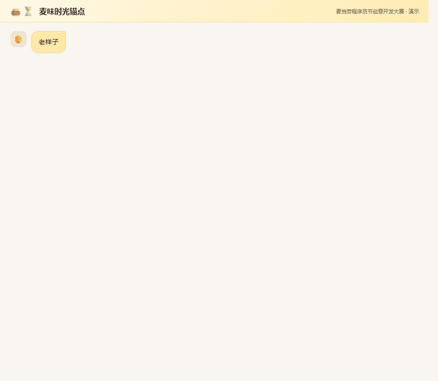
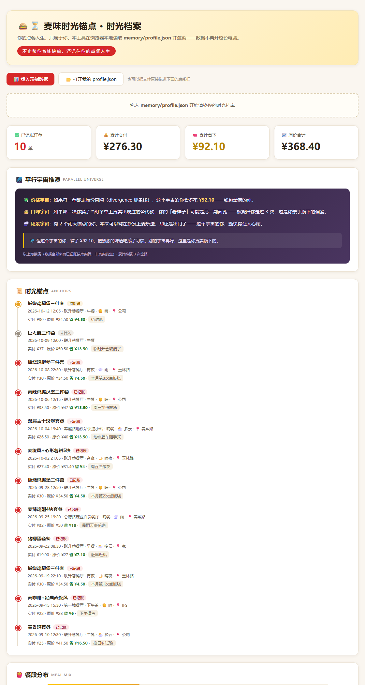

# 🍔⏳ 麦味时光锚点 mcd-time-anchor

> 一句话点单，自动省钱，还把你的点餐人生记成时光档案。
>
> 「老样子。」——三个字，从搜店到最优价订单一气呵成。

基于 [麦当劳中国 MCP Server](https://github.com/M-China/mcd-mcp-server) 开发的纯对话式点餐 Skill，无 GUI、零学习成本。为「麦当劳程序员节创意开发大赛」而作。



> 上面是完整一轮真实流程：说「老样子」→ Skill 后台调 4 个 MCP 工具生成最优订单 → 说「付了」→ 订单对账后写入时光档案 → 说「平行宇宙」→ 从真实锚点交叉推演。
> 想自己跑着看：打开 `demo/animated-demo.html`（自动播放，无需点击）。

---

## 这是什么

三个核心能力，一个 Skill：

### ⚡ 麦味老样子 · 极速单（实用）

- **一句话下单**：说「老样子」，直接按你的固定单生成最优订单，无需翻菜单
- **券额最优组合**：自动核对账号全量优惠券与门店可用券，算出最省钱的组合与凑单方案（`calculate-price` 实算，不拍脑袋）
- **个性化备注自动带入**：去冰、多酱、少糖——记忆里有，订单里就有
- **门店直达**：说「春熙路」就能定位附近门店，基础版不依赖任何地图 API

### ⏳ 时光锚点 · 点餐记忆（情感）

每次点餐完成，静默沉淀一条「时光锚点」：时间、门店、餐品、花费、省了多少，还带一帧场景快照（餐段/天气/位置，取决于你的配置档位）。

下次开口，它记得你的故事：

> 📌 这是你本月第 3 次点板烧鸡腿堡三件套，比上次省了 4.5 元——因为你新领的券到账了。
>
> 📌 周五晚上 10 点，你总在这家店点宵夜，这是第 5 次。

越用越懂你，最终沉淀成一份**只属于你的点餐时光档案**。

### 🌌 平行宇宙 · 岔路推演（脑洞）

每条时光锚点都藏着一个岔路口：当时没走的那条线——原价直购的组合、没点的另一款、没去的另一家店。说「平行宇宙」，它替你交叉推演：

> 🌌 价格宇宙：如果每次都选原价直购，这个宇宙的你会多花 128.5 元——钱包最薄的你。
>
> 🌌 口味宇宙：如果第 4 次你选了当时菜单上的龙焰鸡腿堡，你的「老样子」可能是它。
>
> 🌌 但这个宇宙的你，省了 36 元，第 8 次吃到熟悉的味道。别的宇宙再好，这里是你真实攒下的。

所有推演都标注「推演」，数据全部来自你的真实锚点实算——不编造，只分岔。

### 🔧 能力分级：基础版即用，增强版更强

| | 基础版（默认） | 增强版（可选） |
|---|---|---|
| 依赖 | 仅麦当劳 MCP | + 高德/百度地图 key（免费个人额度） |
| 门店定位 | 城市/商圈/地标关键词搜索 | 精确 POI 解析 + 实距标注（"就在你公司楼下 200 米"） |
| 场景感知 | 餐段（早/午/晚/宵夜） | + 天气（雨天推热饮、高温推冰饮、恶劣天建议麦乐送） |
| 平行宇宙 | 价格/口味/门店维度 | + 场景维度（"那个雨夜的你……"） |

不申请 key？基础版完整可用，零门槛。想要更准？去 [高德开放平台](https://lbs.amap.com) 或 [百度地图开放平台](https://lbsyun.baidu.com) 注册申请 key（免费额度足够个人使用），配给承载本 Skill 的智能体即可，Skill 自动探测、自动生效。

---

## 快速开始

### 0. 前置依赖：接入麦当劳 MCP（一次性配置）

本 Skill 的所有点餐能力都来自麦当劳官方 MCP Server（`https://mcp.mcd.cn`）——**没配它，Skill 装了也跑不起来**。任何支持 MCP 协议（Streamable HTTP）的智能体/客户端都能接入：

1. 访问 [麦当劳 MCP 开放平台](https://open.mcd.cn/mcp)，手机号登录 → 控制台 → 激活并复制 MCP Token（详细图文见[官方指南](https://github.com/M-China/mcd-mcp-server#1-%E7%94%B3%E8%AF%B7-mcp-token)）
2. 在你的智能体中按本仓库 `mcp-config.example.json` 添加 `mcd-mcp` 服务，把 `${MCD_MCP_TOKEN}` 替换为你的真实 Token

<details>
<summary><b>以 WorkBuddy 为例</b>（点开）</summary>

左侧【专家·技能·连接器】→【连接器】→【自定义连接器】→【配置MCP】，粘贴 JSON 并替换 Token，保存后【启用】。
其他客户端（Cursor / Trae / Cherry Studio / VSCode 等）按各自 MCP 配置入口操作，或参照[官方指南平台教程](https://github.com/M-China/mcd-mcp-server#26-%E5%90%84%E5%B9%B3%E5%8F%B0%E6%8E%A5%E5%85%A5%E6%95%99%E7%A8%8B)。

</details>

> ⚠️ Token 等同你的麦当劳账号凭证：只填在客户端配置里，切勿写进任何会被提交或分享的文件。

### 1. 安装 Skill（通用方法）

本 Skill 的本体就是一份结构化提示词 `skill/SKILL.md`——把它交给任何**已接入麦当劳 MCP** 的智能体即可：

- **通用做法**：将 `SKILL.md` 全文作为智能体的系统提示词 / 自定义指令 / 技能文件装入，并将记忆目录指向本仓库 `skill/` 下的 `memory/`（运行时自动创建）
- **以 WorkBuddy 为例**：将 `skill/` 目录作为技能导入即可

### 2.（可选）接入增强能力：地图 / 天气 key

基础版零门槛。想要精确门店定位和天气场景点餐，自行申请免费个人额度的 key 并配置给承载本 Skill 的智能体（环境变量或配置项均可）：

- `AMAP_KEY` —— [高德开放平台](https://lbs.amap.com)（地理编码 + POI + 天气 API，一张 key 全包，推荐）
- `BAIDU_MAP_KEY` —— [百度地图开放平台](https://lbsyun.baidu.com)（与高德二选一）

Skill 启动时自动探测，key 缺失或失效一律静默降级到基础版，不报错不打扰。

### 3. 建立你的「老样子」

第一次点餐时说：「帮我记住这个作为老样子」。之后每次，三个字搞定。

---

## 使用示例

```text
你：老样子
AI：🔍 找到你的常用单：板烧鸡腿堡三件套（去冰可乐）
    📍 上次门店：成都锦江区联升巷餐厅（07:00-23:59 营业中）
    🎟️ 已自动匹配最优券：立减 ¥4.5
    ✅ 已生成订单：¥30.0（原价 ¥34.5）
    👉 支付链接：https://... （15 分钟内有效）

你：我想吃点辣的，随便配，在春熙路
AI：🌶️ 附近 3 家营业中门店，最近 173 米……
    推荐龙焰鸡腿堡三件套（¥26.9，立省 ¥21.6）……

你：平行宇宙
AI：🌌 价格宇宙：如果每次都走原价直购，这个宇宙的你已多花 128.5 元……
    🌌 口味宇宙：如果第 4 次你换了龙焰鸡腿堡……
    🌌 但这个宇宙的你省了 36 元。别的宇宙再好，这里是你真实攒下的。（推演）
```

---

## 📊 时光档案可视化器

仓库自带零依赖单文件网页工具 `web/time-anchor-viewer.html`——**双击即用**（`file://` 直接跑，无需服务器、无外部依赖）。把 `memory/profile.json` 拖进去，你的时光档案立刻变成看得见的东西：



- **打开自己的档案**：点「打开我的 profile.json」或直接把文件拖进虚线框
- **看演示**：浏览器打开 `web/time-anchor-viewer.html?demo=1`，内置示例数据一键渲染
- **看什么**：统计卡片（已记账订单 / 实付 / 省下）、平行宇宙推演面板、时光锚点时间线、餐段分布、场景标签、可筛选明细表
- **隐私**：100% 本地渲染，不发起任何网络请求，数据不出这台设备

> 档案真实性同样体现在这里：`pending`（待对账）与 `cancelled`（未支付/取消）的锚点会被明确标注，**不计入任何统计**。

---

## 仓库结构

```text
mcd-time-anchor/
├── README.md                    # 本文件
├── CONTEST_DECLARATION.md       # 参赛声明（官方模板，未修改）
├── MCP_INTEGRATION.md           # MCP 对接细节 + 全量实测记录
├── mcp-config.example.json      # MCP 配置示例（仅环境变量占位符）
├── workbuddy.md                 # WorkBuddy 开发上下文（专项奖励材料）
├── skill/
│   └── SKILL.md                # ⭐ Skill 本体：6 大流程 + 记忆库规范 + 红线
├── web/
│   └── time-anchor-viewer.html # 时光档案可视化器（双击即用，?demo=1 看演示）
├── demo/
│   ├── animated-demo.html       # 自动播放流程演示页
│   └── memory-profile.example.json  # 示例数据（含 pending/cancelled 真实状态流）
├── docs/
│   └── ISSUE_TEMPLATE.md        # 报名 Issue 模板
├── assets/                      # 截图与演示 GIF
└── scripts/
    └── api-commit.sh            # 开发工具：GitHub API 提交脚本
```

---

## 工作原理

```text
用户一句话
   │
   ▼
┌─────────────────────────────────────────────┐
│  Skill（本仓库 skill/SKILL.md）              │
│  ① 意图识别 → ② 记忆库读取/写入              │
│  ③ 门店路由（query-nearby-stores 关键词搜索） │
│  ④ 菜单与券核对（query-meals / 券接口）       │
│  ⑤ 最优价计算（calculate-price）             │
│  ⑥ 创建订单（create-order → 支付链接）        │
│  ⑦ 时光锚点落盘（memory/profile.json）        │
└─────────────────────────────────────────────┘
   │
   ▼
麦当劳 MCP Server（https://mcp.mcd.cn）
```

基础版只依赖麦当劳 MCP 原生能力 + Skill 本地记忆；增强版额外调用你自己配置的高德/百度地图与天气接口，同样不经过任何中间服务器。

---

## 目标用户

- 每周固定吃麦当劳的「老样子党」：懒翻菜单、不想比价
- 麦门收藏家：不想错过任何一张能用的券
- Agent 重度用户：希望在对话里顺手解决点餐，不想再开一个 APP

---

## 隐私承诺

- 时光锚点与偏好画像**仅保存在你本机的记忆目录**（`memory/profile.json`，位置优先取智能体持久化目录，其次为当前工作区）
- 记忆不上传、不同步；增强版调用地图/天气接口时**只发送地址/城市名等必要参数**，绝不携带任何记忆内容
- 删除 Skill 即彻底删除全部记忆
- 配置文件仅使用环境变量占位符，仓库内不含任何真实凭证

---

## FAQ

**Q：能自动帮我付款吗？**
A：不能。`create-order` 返回支付链接，付款永远由你在麦当劳官方收银台完成——这是安全边界，不是缺陷。

**Q：「和去年同一天」这种文案真能实现吗？**
A：记忆从你使用第一天开始积累。上线初期是「本月第 N 次」，攒得越久，时光档案越有味道。

**Q：为什么用对话点餐而不是自己翻 APP？**
A：省的是手感和时间——券、备注、门店一次说清，直接下单。麦当劳官方 APP 的完整功能与活动信息仍以官方渠道为准。

**Q：档案里的记录保真吗？**
A：只保真。下单先生成「待记账」，下次对话或你说「付了」时用订单接口核对，确认支付才计入时光档案与平行宇宙推演；取消或未付的单，档案里不留。

---

## 参赛说明

本项目为麦当劳程序员节创意开发大赛参赛作品，独立开发，非麦当劳官方产品。餐品信息、价格及供应状态以麦当劳官方渠道实时结果为准。参赛声明见 [CONTEST_DECLARATION.md](CONTEST_DECLARATION.md)，MCP 能力对接细节见 [MCP_INTEGRATION.md](MCP_INTEGRATION.md)。

---

⭐ 如果这个创意打到了你——点餐是刚需，记忆是礼物——给个 Star，让它亮在排行榜上。
